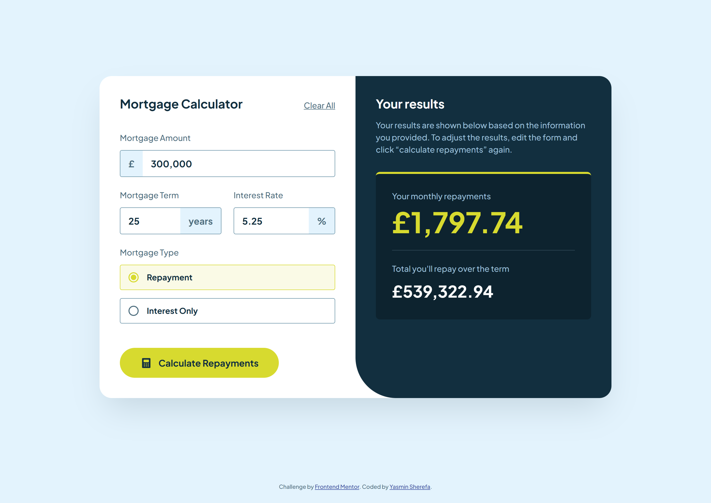
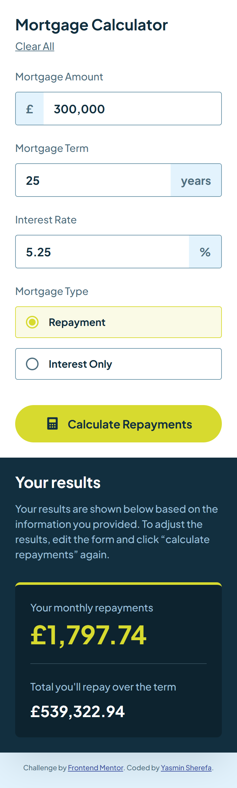

# Mortgage repayment calculator (TypeScript)

My solution to the Mortgage repayment calculator challenge on [Frontend Mentor](https://www.frontendmentor.io/challenges), rebuilt with TypeScript.

## Screenshots

| Desktop | Mobile |
| --- | --- |
|  |  |

## Overview

A mortgage calculator that takes the loan amount, term, interest rate and mortgage type, then shows the monthly and total repayments.

Users can:

- Enter their mortgage details and see the monthly and total repayment after submitting
- See an error message under every field that is empty or invalid
- Complete the whole form with the keyboard only
- See hover and focus states on all interactive elements
- Use the calculator on mobile and desktop
- Reset the form with "Clear All"

## Built with

- Semantic HTML5
- CSS custom properties, Flexbox and CSS Grid
- Mobile-first workflow
- TypeScript (strict mode)
- Plus Jakarta Sans font, loaded locally

## Project structure

```
├── index.html
├── style.css
├── src/script.ts      <- the code I write (TypeScript)
├── dist/script.js     <- compiled output that the browser runs
├── tsconfig.json      <- TypeScript settings
├── package.json       <- scripts and the TypeScript dependency
└── assets/            <- fonts and images
```

Browsers can't run TypeScript, so `tsc` compiles `src/script.ts` into `dist/script.js`. I commit the `dist` folder because GitHub Pages only serves static files.

## How I used TypeScript

- **Strict mode** is on, including `noUncheckedIndexedAccess` and `noUnusedLocals`, so the compiler catches mistakes before the code runs.
- **Union types:** `type MortgageType = "repayment" | "interest-only"` means the type can only be one of those two values.
- **Interfaces:** `MortgageInput`, `MortgageResult` and `FieldRule` describe the shape of the data passed around.
- **Type guard:** `isMortgageType()` checks that a string from the page really is a valid mortgage type before the calculation uses it.
- **Typed DOM access:** a small generic helper, `getElement<T>()`, finds an element, throws a clear error if it is missing, and returns it with the right type (for example `HTMLInputElement`).
- **Typed events:** event handlers use `SubmitEvent` and `FocusEvent`.

## How it works

1. On submit, each field is checked: empty, not a number, zero, or too large.
2. If anything is wrong, error messages are shown, `aria-invalid` is set, and focus moves to the first invalid field.
3. If everything is valid, the repayment is calculated and formatted as GBP with `Intl.NumberFormat`.

**Formula (repayment):** `M = P × r(1 + r)^n / ((1 + r)^n − 1)`, where `P` is the amount, `r` is the monthly rate (annual rate ÷ 12 ÷ 100) and `n` is the number of months.

**Interest only:** the design doesn't show this case, so I made a choice. The monthly payment is `P × r`, and the total is that payment times the number of months. This total leaves out the original loan, which is still owed at the end of the term.

## Run it locally

You need [Node.js](https://nodejs.org) installed.

```bash
npm install        # installs TypeScript
npm run build      # compiles src/script.ts to dist/script.js
npm run watch      # recompiles every time you save (optional)
npm run typecheck  # checks types without writing files (optional)
```

Then open `index.html` with the Live Server extension in VS Code.

## What I learned

- How to set up a TypeScript project with `tsconfig.json` and compile it with `tsc`.
- How to describe data with types and interfaces, and why strict mode catches bugs early.
- How to work safely with the DOM when an element might be `null`.

## Continued development

- Test the results announcement with a screen reader such as NVDA. I added the `aria-live` region but have not tested it yet.
- Add a tablet layout.
- Add automated tests for the calculation function.

## Author

Yasmin Sherefa